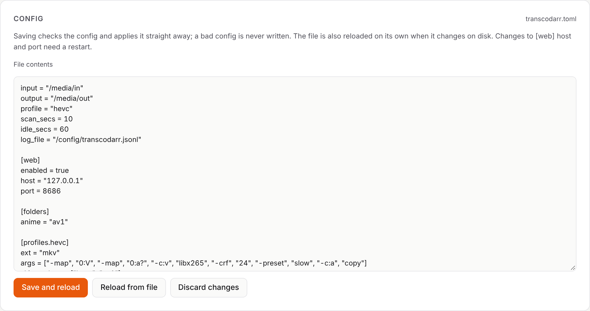

# Transcodarr reference

Everything the [README](../README.md) leaves out.

## How it works


1. The watcher checks ffmpeg and ffprobe at startup. It scans every `idle_secs` (default 60) when idle. A new video must keep the same size and modification time for at least `scan_secs` (default 10). A producer that may pause mid-copy can write under a dot-prefixed name and rename the finished file into place.
2. The watcher reserves the output and moves the input into `.transcodarr-processing/` inside its watched folder. A new arrival with the same name stays in the inbox. Each watched folder supports one active watcher.
3. Both `run` and `encode` use a unique temporary output under the output folder's `.transcodarr/`. They check ffmpeg's diagnostics and probe the result before publishing it. An existing output is left in place.
4. Successful originals move to `done/`. With `delete_source = true`, deletion also requires verified container, video, and audio durations and at least as many streams of each type as the original. A substantial duration shortfall fails verification. A smaller shortfall beyond timestamp rounding, an unknown duration, or a duration-changing profile keeps the original in `done/`.
5. Damaged inputs move to `failed/` with a diagnostic log. A missing tool at startup stops the watcher before it claims any inputs. Tool failures during a job and output-storage errors leave the job queued for retry. A claimed file stays in `.transcodarr-processing/` until the worker can finish it.

`jobs` files encode at once (default 1). A restart picks up claimed files. If the output already exists for an interrupted job, the original moves to `done/` even when deletion is enabled. Name collisions in `done/` and `failed/` use numbered prefixes.

## Docker image

The image is [distroless](https://github.com/GoogleContainerTools/distroless). It holds Transcodarr, ffmpeg and
ffprobe 9.0 from [BtbN/FFmpeg-Builds](https://github.com/BtbN/FFmpeg-Builds) (x264, x265, SVT-AV1, NVENC) and glibc.
There is no shell inside it. Images are published for `linux/amd64` and `linux/arm64`, tagged `latest` and with each
version, such as `0.4`.

```sh
docker run --rm ghcr.io/aaronburt/transcodarr --version
docker run --rm --entrypoint ffmpeg ghcr.io/aaronburt/transcodarr -hide_banner -encoders
```

On first start the container copies its default config to `/config/transcodarr.toml` (`--default-config`). It runs as
root. To keep your own file ownership, add `user: "1000:1000"` to the service and make sure `config/` and `media/`
belong to that user.

To build the image from a checkout instead of pulling it:

```sh
docker compose -f compose.yaml -f compose.build.yaml up -d --build
```

The bundled ffmpeg is GPL. The exact build is pinned in the `Dockerfile`, and its source is the matching FFmpeg commit
plus the build scripts in BtbN/FFmpeg-Builds.

## Config

| Key | Default | What |
| --- | --- | --- |
| `input`, `output` | required | the watched folder and where encodes go |
| `profile` | required | the profile `run` uses, and `encode` unless `-p` is given |
| `scan_secs` | 10 | scan interval while a file is still being copied |
| `idle_secs` | 60 | scan interval when nothing is waiting |
| `extensions` | `mp4 mkv mov avi m4v ts webm` | which files count as videos |
| `ignore` | none | file name patterns to leave alone, with `*` and `?`, case-insensitive, e.g. `["*.part", "sample*"]` |
| `output_name` | `{name}` | output file name before the extension; `{name}` is the input's name, `{profile}` the profile's, e.g. `"{name} [{profile}]"` |
| `jobs` | 1 | how many encodes run at once; 1 suits CPU encoding, NVENC handles 2–3 |
| `ffmpeg`, `ffprobe` | `ffmpeg`, `ffprobe` | paths to the binaries, if they aren't on the `PATH` |
| `done_dir`, `failed_dir` | `done/`, `failed/` in each watched folder | where originals go after encoding |
| `delete_source` | false | delete originals after a full-length encode passes duration and stream-count checks |
| `log_file` | none | append every event to this file as one JSON object per line, for scripts or an AI to read |
| `[folders]` | none | subfolders of `input` with their own profile, e.g. `anime = "av1"`; their encodes go to `output/anime/` |
| `[web]` `enabled`, `host`, `port` | off, `127.0.0.1`, 8686 | the status page; a `[web]` section turns it on, and `--web` overrides it |
| `[web]` `password` | none | asks for this password (any username) before showing the page |

Set `host = "0.0.0.0"` to reach the page from other machines, and read [Security](#security) first.

`output_name` must contain `{name}`. ffmpeg is started directly, not through a shell, so shell quoting
doesn't matter. Characters Windows doesn't allow in file names (`<>:"/\|?*`) become `_`, as does a leading `-`.
The file always lands inside the output folder.

## Web page



The page shows what's encoding, waiting and recently finished, live over a WebSocket at `/ws` (the same JSON is
at `GET /api/status`). It can also:

- **Edit the config:** the whole `transcodarr.toml` in a text box. Saving checks it first and never writes a bad
  config, then applies it straight away. Changes to `[web]` `host` and `port` need a restart.
- **Reload the config:** with a button, or on its own when the file changes on disk (noticed on the next scan).
  A broken file is reported on the page and the old config keeps running.
- **Retry a failed file:** moves it from `failed/` back into its watched folder.

## Security

The status page is meant for your own machine or home network. Read this before exposing it anywhere else.

- **Editing needs localhost or a password.** The config can name any program as `ffmpeg`, so whoever can edit it
  can run commands as Transcodarr's user. Without a `password` the page is read-only unless you open it on
  localhost. In Docker the request comes from the Docker network, not localhost, so set a `password` to edit there.
- **The password is sent in the clear.** It uses HTTP Basic auth over plain HTTP, so anyone on the network path can
  read it. Use a password you don't use anywhere else. To reach the page from outside your network, put it behind a
  reverse proxy with HTTPS (Caddy, nginx, Traefik) or a VPN such as Tailscale, never a bare port forward.
- **The password is stored in plain text** in `transcodarr.toml`. Keep that file readable only by you.
- **Edits must come from the page itself.** Requests from other websites open in your browser are refused, so a
  malicious page can't change your config through your browser.

To report a security problem, open a [private advisory](https://github.com/aaronburt/transcodarr/security/advisories/new)
rather than a public issue.

## Profiles

A profile is the ffmpeg args between `-i <input>` and the output file, plus the output extension, so GPU
encoders (`hevc_nvenc`, `hevc_qsv`, ...) need nothing special. See `transcodarr.example.toml`.

Each profile can also have `input_args`, ffmpeg args that go before `-i`, such as `["-hwaccel", "cuda"]` to decode
on the GPU as well as encode there.

Each profile can also have `skip_codecs`, e.g. `["av1"]`: a file whose video is already in one of those codecs (as
ffprobe names them) isn't re-encoded, and its original goes straight to done.

Each profile can also re-encode only some audio tracks. List the codecs to replace in `audio_reencode` (as ffprobe
names them) and the encoder options for those tracks in `audio_args`. Every other track keeps the profile's own
audio args, usually `-c:a copy`:

```toml
[profiles.hevc]
ext = "mkv"
args = ["-map", "0:V", "-map", "0:a?", "-c:v", "libx265", "-crf", "24", "-c:a", "copy"]
audio_reencode = ["truehd", "dts", "flac", "pcm_s16le", "pcm_s24le"]
audio_args = ["-c", "libopus", "-b", "192k"]
```

A film with a TrueHD main track and an AAC commentary comes out with an Opus main track and the untouched AAC.
Transcodarr turns `audio_args` into per-track options such as `-c:a:0 libopus -b:a:0 192k`, so write the options
without a stream specifier. The track numbers follow the source's audio order, so the profile should map every audio
track (`-map 0:a?` or `-map 0`). libopus can't encode some 5.1 layouts; `["-c", "aac", "-b", "384k"]` is the safer
choice for surround tracks.

By default a decode error stops the encode and the file moves to failed. Set `ignore_errors = true` on a profile to
encode through glitches instead, which suits recordings like `.ts` captures. The output is still checked with ffprobe,
so a file that ends far too short still fails.

Profiles default to `preserve_duration = true`. Set it to `false` on profiles that intentionally trim or speed up a
video. Transcodarr then accepts the changed duration and keeps the source. The example profiles map every audio
track. The Matroska profiles also map subtitles and attachments.

## Event log

With `log_file` set, `run` appends one JSON object per line. Each has `time` (Unix seconds) and `event`:

| Event | Fields |
| --- | --- |
| `started` | `watches` (folder, profile and output paths), `jobs`, `scan_secs`, `idle_secs` |
| `encode_started` | `file`, `input`, `output`, `profile`, `input_args`, `args`, and `source` (what ffprobe found) |
| `finished` | `result` (`done`, `failed` or `skipped`), sizes, `took_secs`, `note`, `input`, `output`, and `ffmpeg_output` (the last 40 lines of ffmpeg's output) when it failed |
| `queued_for_retry` | `file`, `error` (a tool or disk problem, tried again later) |
| `config_reloaded`, `config_error` | `error` when the new config was rejected |
| `retry_requested` | `file`, when Retry was pressed on the web page |


## Code

| File | What |
| --- | --- |
| `main.rs` | argument parsing and the three commands |
| `config.rs` | the TOML config and profiles |
| `scan.rs` | the watch loop and done/failed moves |
| `encode.rs` | running ffmpeg and reading its progress |
| `status.rs` | state shared by the loop and the page: live config, reload, retry, status |
| `web.rs`, `index.html` | the web page and its actions, on `std::net` |
| `ws.rs` | the minimal WebSocket handshake and frames (SHA-1 and base64 included) |

Runtime dependencies are `serde`, `toml` and `serde_json`; `tempfile` is only used by the tests.

## Development

```sh
cargo fmt --check
cargo clippy --all-targets -- -D warnings
cargo test --locked
```

The watcher tests need `ffmpeg` and `ffprobe` on the `PATH`, with the libx264 and libx265 encoders. CI runs all of
this on every push and pull request.

Every merge to `main` that passes CI is released automatically. The version is `MAJOR.MINOR`, and the minor number
goes up by one each release (`v0.1`, `v0.2`, ...). The release workflow builds the binaries, attaches them to a GitHub
release with notes generated from the merged pull requests, and pushes the `0.2` and `latest` images. To start a
new major version, push a tag such as `v1.0` on `main`; the next merges become `v1.1`, `v1.2` and so on.

